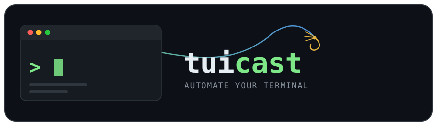

# TUICast

**Automate and test terminal applications over SSH and Telnet.**

TUICast is an open-source tool for testing and automating interactive
terminal applications, such as warehouse management systems (WMS) used from RF
terminals. It connects over SSH or Telnet, emulates a VT220 or xterm terminal,
and lets your code type, press keys, wait for screens, and check what the
application displayed. Think of it as Playwright for terminal applications.

<!-- Badges: one repository-wide test badge, then per-component coverage. -->

Signing in to a warehouse application over SSH and checking the main menu
looks like this in Python:

```python
import os
import tuicast

with tuicast.Driver.launch() as driver:
    with driver.connect(tuicast.SSH(
        "wms-test.example.test:22", "rfuser",
        password=os.environ["WMS_SSH_PASSWORD"],
        known_hosts_file=os.path.expanduser("~/.ssh/known_hosts"),
    )) as connection:
        with connection.open_session(terminal=tuicast.Terminal.VT220) as session:
            session.wait_for_text("User ID:")
            session.type("operator")
            session.press(tuicast.Key.TAB)
            session.type(os.environ["WMS_APP_PASSWORD"])
            session.press(tuicast.Key.ENTER)
            screen = session.wait_for_text("MAIN MENU")
            assert screen.contains("Receiving")
```

## Why TUICast

Terminal applications are hard to automate because they are screens, not
streams of lines. Output arrives in pieces, escape sequences redraw parts of
the screen in place, input includes function keys, and nothing signals that a
screen is ready. TUICast handles all of that:

- **Real screen state.** An emulated terminal keeps the screen, cursor, colors,
  and attributes, so tests check what a user would see.
- **Waits, not sleeps.** Wait for text, exact lines, cursor positions, or
  combinations, with optional quiet periods for screens that draw slowly.
- **Many isolated sessions.** Simulate many concurrent users, each with its
  own screen, across SSH and Telnet connections.
- **Your language.** SDKs for Go, Python, TypeScript, and Java, and a JSON-RPC
  driver for anything else.
- **Diagnosable failures.** A failed wait reports the last screen and the host
  output that led to it.
- **AI agents, safely.** An optional MCP server lets agents operate only the
  connections an operator approves.
- **No application changes.** TUICast sees exactly what a user's terminal
  sees.

## Install

Install the driver, which every SDK launches:

```sh
brew install --cask castingcode/tap/tuicast           # macOS
winget install --exact --id CastingCode.TUICast       # Windows
npm install --global @castingcode/tuicast-cli         # any platform
```

Then add an SDK:

```sh
go get github.com/castingcode/tuicast/sdk/go@latest   # Go
python -m pip install tuicast                         # Python
npm install @castingcode/tuicast                      # TypeScript
```

For Java, use the Maven artifact `dev.castingcode:tuicast`. For Scoop, Linux
packages, install scripts, containers, and `go install`, see
[Installation](docs/content/getting-started/installation.md).

## Get started

Follow a 15-minute guide that automates a login on the included
[reference TUI](docs/content/getting-started/reference-tui.md):
[Go](docs/content/getting-started/go.md) ·
[Python](docs/content/getting-started/python.md) ·
[TypeScript](docs/content/getting-started/typescript.md) ·
[Java](docs/content/getting-started/java.md)

## How it works

```text
┌───────────┐  JSON-RPC  ┌────────────────────┐  SSH or  ┌──────────────┐
│ Your code │◀──────────▶│ tuicast-driver     │◀────────▶│ Terminal     │
│ + SDK     │   stdio    │ terminal emulation │  Telnet  │ application  │
└───────────┘            │ screen state, waits│          │              │
┌───────────┐    MCP     ├────────────────────┤          │              │
│ AI agent  │◀──────────▶│ tuicast-mcp        │◀────────▶│              │
└───────────┘            └────────────────────┘          └──────────────┘
```

Each SDK starts its own `tuicast-driver` process, which owns the connections,
terminal emulation, and waits. Go programs can also embed TUICast as a
library. Read more in
[How TUICast works](docs/content/concepts/how-tuicast-works.md).

## Documentation

- [Concepts](docs/content/concepts/): how sessions, screens, and waits work
- [Guides](docs/content/guides/): connecting to your application, diagnosing
  failures, AI agents, CI
- [Reference](docs/content/reference/): flags, keys, matchers, the driver
  protocol, and MCP configuration
- [Glossary](docs/content/glossary.md) and [FAQ](docs/content/faq.md)
- [Examples](examples/README.md): runnable, tested examples in every language

## Contributing

The [Taskfile](Taskfile.yml) runs the same checks as CI. Install
[Task](https://taskfile.dev/installation/), then run:

```sh
task ci          # every check, in order
task check       # Go formatting, vet, tests, and examples
task java        # Java SDK and examples (Maven, Java 21)
task typescript  # TypeScript SDK and examples
task python      # Python SDK and examples (Python 3.12)
```

Run `task` to list individual steps. The example tests start the reference TUI
on the addresses in `.env`; set different addresses in `.env.local` if those
ports are busy. As in CI, each run generates fresh passwords unless
`.env.local` provides them.

Design decisions are recorded in [`design/`](design/). Documentation
conventions are in [`docs/README.md`](docs/README.md).

## License

TUICast is available under the [MIT License](LICENSE).
